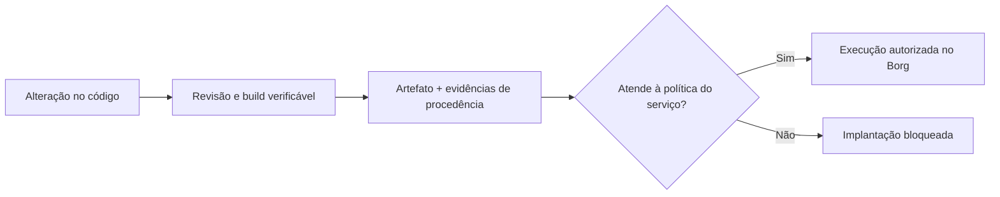

# 04 — A solução: Binary Authorization for Borg (BAB)

## Visão geral

O **Binary Authorization for Borg (BAB)** integra-se ao sistema Borg para conferir se um trabalho atende à **política de segurança do serviço** antes de receber autorização para executar com a identidade desse serviço.

O Google utiliza evidências verificáveis — entre elas, informações assinadas do processo de build — para relacionar os artefatos a suas fontes e às regras aplicáveis.

## Quatro perguntas para entender o controle

Estas são **perguntas didáticas** para introduzir o BAB; não constituem a lista oficial de etapas do processo do Google.

1. **Revisão:** quem revisou e aprovou o código?
2. **Build:** o artefato foi construído pelo processo esperado?
3. **Evidências:** existem registros verificáveis que ligam o artefato à sua origem e à configuração?
4. **Autorização:** a política do serviço permite que esse trabalho execute?

## Fluxo simplificado

Esse diagrama mostra o **caminho padrão simplificado**. A documentação oficial também descreve verificação contínua, políticas mais permissivas em casos específicos e procedimentos de emergência auditados. Portanto, não é correto afirmar que toda tentativa fora da política é bloqueada em absolutamente todas as circunstâncias.

## Quais são as quatro etapas formais descritas pelo Google?

A documentação oficial lista **quatro passos padrão do processo de desenvolvimento e produção** — diferentes das perguntas didáticas acima:

1. **Code review:** revisão do código-fonte.
2. **Verifiable builds:** builds verificáveis, que geram informações assinadas de procedência.
3. **Containerized deployment:** implantação usando imagens de contêiner e o Borg.
4. **Service-based identity:** identidade do serviço, usada para definir permissões e aplicar controles.

## Detalhe técnico essencial

Na verificação no momento do deploy, o controlador do Borg consulta o BAB antes de autorizar a execução do trabalho com a identidade do serviço. A decisão depende da **política específica daquele serviço**; não existe uma regra única que represente todos os serviços.

## Frase-chave para a apresentação

> **No Google, não basta confiar que o software é legítimo: é preciso verificar as evidências que permitem autorizá-lo.**

A explicação aprofundada de políticas, provas criptográficas e modos de fiscalização pode ficar com os integrantes responsáveis pelas próximas partes da apresentação.

**Fontes:** [Binary Authorization for Borg](REFERENCIAS.md#1-binary-authorization-for-borg--google-cloud) e [How Google Does It](REFERENCIAS.md#2-how-google-does-it--google-cloud-blog).
