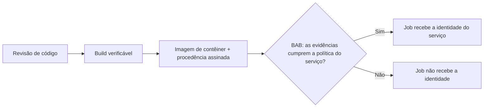

# 05 — Do commit à produção: as quatro etapas obrigatórias

## Visão geral

Na Parte 1, as quatro etapas formais do processo de desenvolvimento e produção do Google foram apenas listadas. Nesta parte, elas são detalhadas, porque o funcionamento do **Binary Authorization for Borg (BAB)** depende diretamente delas.

Cada etapa produz algo que pode ser **conferido depois**: uma aprovação registrada, um certificado de build, uma imagem identificada por hash ou uma identidade de serviço. O BAB é o mecanismo que reúne essas evidências e decide se o trabalho pode executar.

## As quatro etapas

| Etapa | O que acontece | Por que importa para o BAB |
| --- | --- | --- |
| **1. Revisão de código** | A maior parte do código fica em um repositório monolítico central. Toda alteração precisa da aprovação de pelo menos um engenheiro **que não seja o autor** e, no mínimo, dos proprietários do sistema. | Impede que uma única pessoa leve código à produção sozinha. |
| **2. Build verificável** | Um sistema de build semelhante ao **Bazel** compila o código em um ambiente **isolado**, separado dos funcionários que solicitam os builds. A cada build, gera um certificado assinado de procedência. | É a evidência que liga o binário ao código-fonte e ao processo de construção. |
| **3. Implantação em contêiner** | O binário é empacotado em uma **imagem de contêiner** e implantado como um **job do Borg**. A configuração do job define imagem, argumentos e flags. | Os contêineres devem ser **imutáveis**: o que foi verificado é o que executa. |
| **4. Identidade de serviço** | O job executa com uma **identidade de serviço** e recebe credenciais criptográficas para acessar dados e chamar outros serviços. Apenas os responsáveis pelo serviço, normalmente SREs, podem implantar com essa identidade. | É o recurso que o BAB protege: sem a credencial, o job não acessa os dados. |

## Por que o repositório único e os contêineres ajudam?

A documentação do Google destaca dois efeitos dessas escolhas:

- **Ponto único de controle:** com uma base de código monolítica, a revisão de código passa por um único ponto obrigatório (*choke point*). O mesmo vale para os contêineres em relação às mudanças implantadas na infraestrutura.
- **Ambiente homogêneo:** mesmo executando um volume muito grande de jobs, o ambiente de produção é bastante uniforme. Isso facilita auditar e controlar os pontos de acesso aos dados dos usuários.

## Fluxo das etapas

## O que as etapas não garantem sozinhas?

Ter um processo de revisão e um build oficial não basta se ainda for possível **implantar algo que não passou por eles**. Sem uma verificação no momento do deploy, alguém com permissão de implantação poderia contornar o caminho padrão.

Assim, as funções são complementares:

- **As quatro etapas:** produzem as evidências.
- **O BAB:** exige essas evidências antes de conceder a identidade do serviço ao job.

## Frase-chave para a apresentação

> **Cada etapa deixa uma prova que pode ser conferida; o BAB só entrega a identidade do serviço se as provas baterem.**

**Fontes:** [Binary Authorization for Borg](REFERENCIAS.md#1-binary-authorization-for-borg--google-cloud) e [BeyondProd](REFERENCIAS.md#6-beyondprod--google-cloud).
