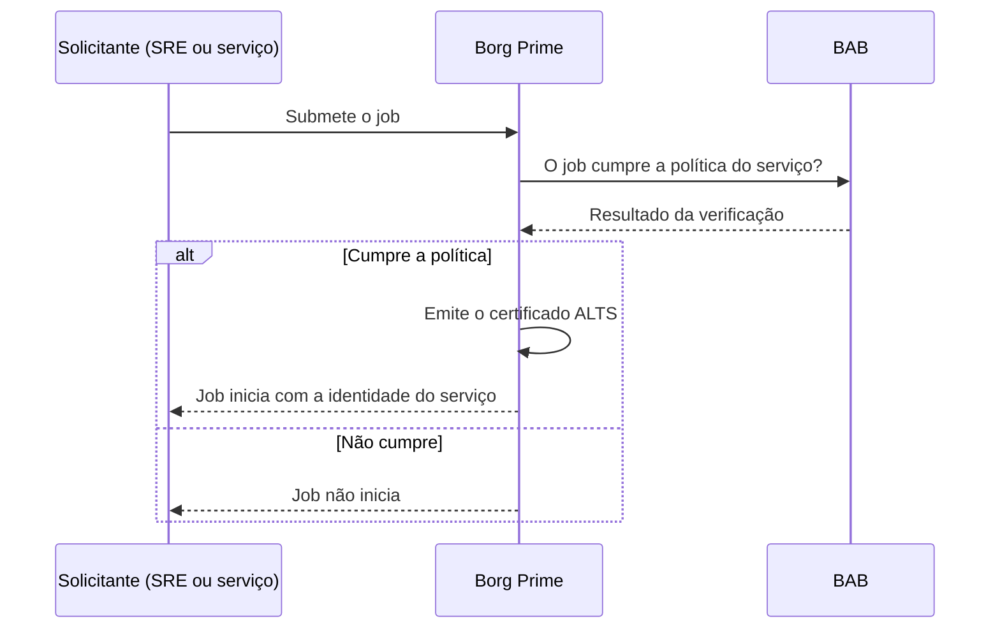

# 08 — A verificação: Borg Prime, BAB e os modos de aplicação

## Quem faz a checagem?

O **Borg Prime** é o controlador centralizado do Borg. Ele também atua como **autoridade certificadora do ALTS** (*Application Layer Transport Security*), o mecanismo que os serviços do Google usam para autenticação mútua e criptografia nas comunicações entre si.

Isso coloca o Borg Prime em uma posição estratégica: **sem o certificado ALTS, um job não consegue provar sua identidade** nem acessar dados ou outros serviços.

**Atenção:** a tradução automática em português da documentação oficial diz "autoridade certificadora do **Pub/Sub**". O texto original em inglês diz "*certificate authority for **ALTS***".

## Fluxo no momento do deploy

Essa verificação funciona como um **controlador de admissão** (*admission controller*): o Borg só inicia o job se ele satisfizer a política específica do serviço. O conceito é o mesmo dos *admission controllers* do Kubernetes.

## Vale até para quem tem permissão

A documentação destaca que a verificação ocorre **mesmo quando o funcionário ou serviço que solicita o deploy está autorizado**.

O objetivo é impedir o **acesso unilateral**: nenhum funcionário, agindo sozinho, deve conseguir acessar ou afetar dados de usuários sem autorização e justificativa. Isso vale independentemente de o ator ter intenção maliciosa, ter a conta comprometida ou ter recebido acesso por engano.

## Os modos de aplicação

| Modo | Quando age | O que faz |
| --- | --- | --- |
| **Aplicação no deploy** (*deploy-time enforcement*) | Antes de o job iniciar | **Bloqueia** jobs que não cumprem a política |
| **Verificação contínua** (*continuous verification*) | Durante toda a vida do job | **Monitora e alerta** sobre jobs em execução fora da política |

Sobre a verificação contínua:

- Ocorre **independentemente** do modo usado no deploy.
- Um processo do BAB executa **pelo menos uma vez por dia**.
- Identifica, por exemplo, jobs com políticas desatualizadas ou implantados por procedimento de emergência.
- Quando encontra uma não conformidade, **notifica os proprietários do serviço**.

Em casos raros, e com justificativa adequada, um serviço pode desativar a aplicação no deploy. Mesmo assim, continua sujeito à verificação contínua.

## E em uma emergência?

Durante um incidente, pode ser necessário executar código ainda não revisado. Para isso existe um **procedimento de resposta a emergências** (*breakglass*), que permite contornar a aplicação no deploy **mediante justificativa**. O uso é registrado, e a equipe de segurança e os proprietários do serviço são notificados.

Esse procedimento é tratado com mais detalhes na Parte 3.

## Trilha de auditoria e conformidade

Além de bloquear, o BAB mantém uma **trilha de auditoria** do código e da configuração usados nos jobs, utilizada para monitoramento e resposta a incidentes.

A mesma base permitiu automatizar verificações de conformidade que antes eram manuais, como as exigidas pela **Lei Sarbanes-Oxley (SOX)** para sistemas de relatórios financeiros.

## Pergunta de transição

> Se cada deploy é conferido contra a política do serviço, o que acontece, na prática, com um programa aprovado, um sem revisão e um alterado depois do build?

Essa é a questão que a demonstração da Parte 3 responde.

**Fontes:** [Binary Authorization for Borg](REFERENCIAS.md#1-binary-authorization-for-borg--google-cloud), [Application Layer Transport Security](REFERENCIAS.md#5-application-layer-transport-security-alts--google-cloud) e [How Google Does It](REFERENCIAS.md#2-how-google-does-it--google-cloud-blog).
