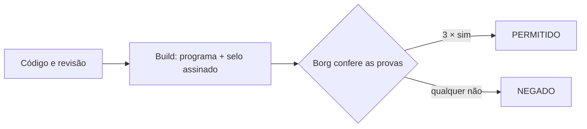

# 09 — Demonstração prática: Mini-BAB

## Visão geral

Para mostrar o BAB funcionando, o grupo construiu o **Mini-BAB**, uma simulação do caminho até a produção. Ela roda no navegador, sem instalação e sem internet: basta abrir [`demo/index.html`](demo/index.html).

O hash (**SHA-256**) e a assinatura (**ECDSA P-256**) são calculados de verdade pelo navegador. O que é simulado é o Borg e o sistema de build.

## As três etapas da demo

| Etapa | O que acontece | Equivalente no Google |
| --- | --- | --- |
| **1. Código e revisão** | Alguém escreve o código e **outra pessoa** aprova. Ninguém aprova o próprio código. | Revisão de código no monorepo |
| **2. Build** | Gera o programa e um **selo de procedência** assinado. | Build verificável, que emite a procedência |
| **3. Deploy no Borg** | O Borg confere as provas antes de liberar. | Borg Prime consultando o BAB antes de emitir a credencial ALTS |

## Como usar

A página abre com um exemplo que dá certo (Alice escreve, Bob revisa). Para provocar as falhas, basta mexer nos controles:

- trocar o **revisor** para "ninguém" ou para o próprio autor;
- usar **Build no notebook** em vez do build oficial;
- clicar em **Alterar o binário depois do build**;
- editar o código depois da revisão.

Também existe uma versão mais completa, para terminal, em [`demo-terminal/`](demo-terminal/): usa um repositório git real e gera proveniência no formato **SLSA v1** (in-toto + DSSE + Ed25519). Para rodar: `pip install cryptography` e `python demo.py`.
