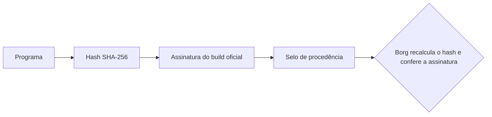

# 11 — Como o Borg sabe que ninguém mexeu?

## Visão geral

O selo de procedência carrega duas provas que ninguém consegue falsificar: o **hash** e a **assinatura**.

| # | Prova | O que é |
| --- | --- | --- |
| **1** | **Hash** | A impressão digital do programa. Se mudar **um único byte**, o hash muda completamente. |
| **2** | **Assinatura** | Feita pelo build oficial com uma chave que **só ele tem**. Prova quem emitiu o selo. |
| **3** | **Selo** | Junta o hash, o commit de origem e a assinatura, e vai junto com o programa. |

## O que cada prova impede

- **Alguém altera o programa depois do build:** o hash recalculado não bate com o do selo.
- **Alguém fabrica um selo falso:** a assinatura não confere com a chave do build oficial.

Na demo, isso aparece quando se clica em **Alterar o binário depois do build**: o hash do binário fica vermelho e diferente do hash do selo.
