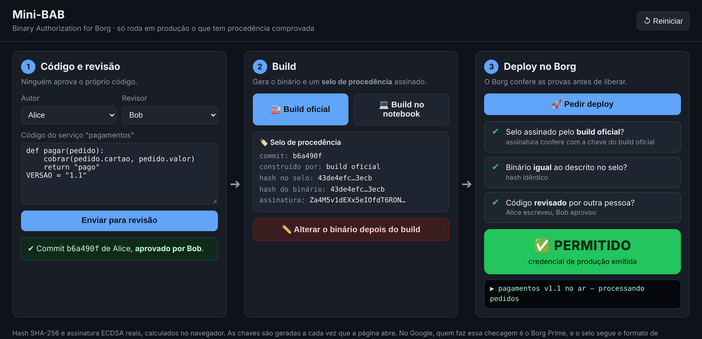

# 12 — Resultado 1: aprovado

## O que aconteceu

| Etapa | Situação |
| --- | --- |
| Revisão | Alice escreveu, Bob aprovou |
| Build | Build oficial, selo assinado |
| Binário | Intacto desde o build |

## O que o Borg conferiu

| Pergunta | Resposta |
| --- | --- |
| Selo assinado pelo build oficial? | ✔ |
| Binário igual ao descrito no selo? | ✔ |
| Código revisado por outra pessoa? | ✔ |

**Resultado: PERMITIDO** — credencial de produção emitida.

É o caminho certo: código revisado por outra pessoa, construído pelo build oficial e sem alteração depois. As três perguntas têm resposta sim.
