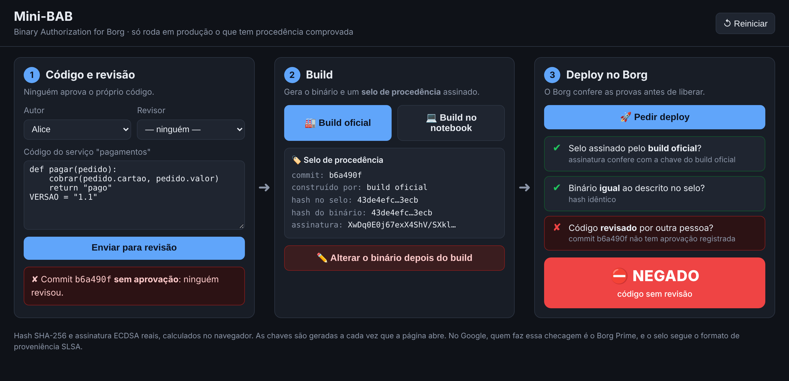

# 13 — Resultado 2: sem revisão

## O que aconteceu

| Etapa | Situação |
| --- | --- |
| Revisão | **Ninguém aprovou o código** |
| Build | Build oficial, selo assinado |
| Binário | Intacto desde o build |

## O que o Borg conferiu

| Pergunta | Resposta |
| --- | --- |
| Selo assinado pelo build oficial? | ✔ |
| Binário igual ao descrito no selo? | ✔ |
| Código revisado por outra pessoa? | ✘ |

**Resultado: NEGADO** — código sem revisão.

A Mallory **tem permissão de deploy** e usa o build oficial, então a assinatura é válida. Mas o código não foi revisado. Esse é o ponto central do BAB: **ter permissão não basta**. Tentar se autoaprovar também não funciona, porque o revisor não pode ser o autor.
