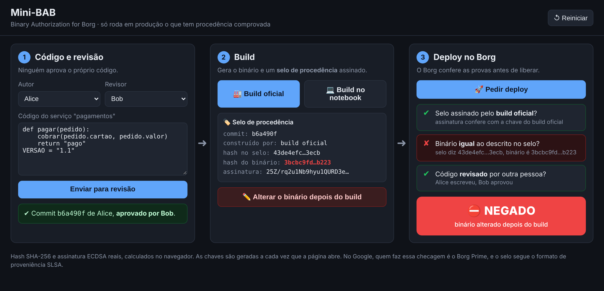

# 14 — Resultado 3: programa alterado

## O que aconteceu

| Etapa | Situação |
| --- | --- |
| Revisão | Alice escreveu, Bob aprovou |
| Build | Build oficial, selo assinado |
| Binário | **Alterado depois do build** |

## O que o Borg conferiu

| Pergunta | Resposta |
| --- | --- |
| Selo assinado pelo build oficial? | ✔ |
| Binário igual ao descrito no selo? | ✘ |
| Código revisado por outra pessoa? | ✔ |

**Resultado: NEGADO** — binário alterado depois do build.

Código revisado e build oficial, mas alguém mexeu no programa depois de pronto. O hash recalculado não bate com o hash registrado no selo.
