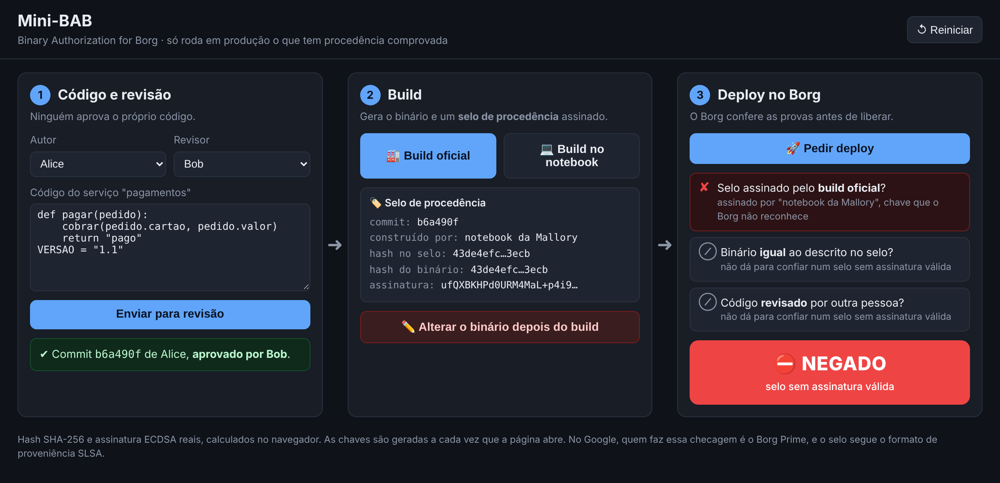

# 15 — Resultado 4: build no notebook

## O que aconteceu

| Etapa | Situação |
| --- | --- |
| Revisão | Alice escreveu, Bob aprovou |
| Build | **No notebook, com chave pessoal** |
| Binário | Intacto desde o build |

## O que o Borg conferiu

| Pergunta | Resposta |
| --- | --- |
| Selo assinado pelo build oficial? | ✘ |
| Binário igual ao descrito no selo? | – (não avaliada) |
| Código revisado por outra pessoa? | – (não avaliada) |

**Resultado: NEGADO** — selo sem assinatura válida.

O programa foi compilado fora do sistema oficial e o selo foi assinado com uma chave pessoal, que a política não reconhece. A primeira pergunta já falha. Como o selo não é confiável, nada do que está escrito nele vale, e as outras perguntas nem são avaliadas.
